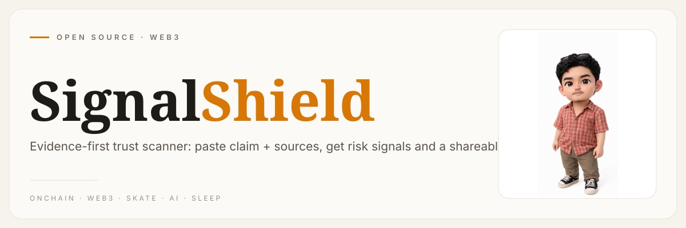
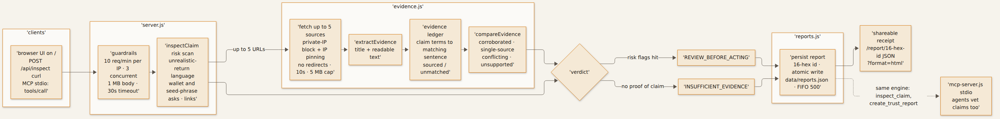

**[urelkdubdqwr](https://github.com/urelkdubdqwr)** · [website](https://studiopinggirkasur.xyz/)

<!-- SignalShield — evidence-first trust scanner -->



[](https://github.com/urelkdubdqwr/signalshield/actions/workflows/ci.yml) [](LICENSE)

**Paste a claim, get receipts: risk signals, source excerpts, and a shareable
trust verdict — before you act on it.** Zero npm dependencies, Node.js only.

## What it is

The internet runs on "trust me bro": guaranteed-return farms, "mint now or cry",
random support DMs. Existing tools hand you an opaque score with no way to check
it. SignalShield does it the boring way — it scans the claim for red-flag
language, fetches the public sources you point it at, shows you the matching
sentences, and tells you what the sources actually say (including when they say
nothing). No proof is never treated as proof: a tool that says "safu" without
receipts is worse than no tool.

**Live demo:** https://signalshield-nlc1.onrender.com

## How it works



1. **Submit.** Browser UI, `POST /api/inspect` with `{"claim", "sources"}`, or
   MCP `tools/call` — a claim plus up to 5 public URLs.
2. **Risk scan.** Deterministic regex pass over the claim: unrealistic-return
   language (`unrealistic-return-language`), wallet/seed-phrase asks
   (`high-risk-action-request`), bare links (`external-link-needs-verification`).
   Any flag → verdict `REVIEW_BEFORE_ACTING`; no flag → `INSUFFICIENT_EVIDENCE`
   until sources prove otherwise.
3. **Safe fetching.** Sources are DNS-checked against private ranges (SSRF
   blocked), then the connection is pinned to the validated IP so DNS rebinding
   can't swap the address mid-fetch. Redirects are refused, 10s timeout, 5 MB
   response cap.
4. **Evidence ledger.** Extracted page text is searched for sentences matching
   claim terms — each source comes back `sourced` (with the excerpt shown) or
   `unmatched`.
5. **Cross-source compare.** With 2+ sources the matches are separated into
   corroborated, single-source, conflicting (negating language like "not" or
   "prohibited"), or unsupported.
6. **Shareable receipt.** Every inspection persists to `data/reports.json` under
   a 16-hex id, served at `/report/<id>` as JSON or `?format=html` — a receipt
   you can forward instead of a vibe you have to take on faith.

## Quickstart

```bash
git clone https://github.com/urelkdubdqwr/signalshield.git
cd signalshield

npm start    # browser UI on http://localhost:8787
npm test     # node --test, same suite as CI
```

Needs Node.js >= 20. No `npm install` — zero dependencies.

Inspect from the API:

```bash
curl -s localhost:8787/api/inspect \
  -H 'content-type: application/json' \
  -d '{"claim":"Users can redeem rewards within 30 days",
       "sources":["https://issuer.example/terms","https://partner.example/faq"]}'
```

Talk to the MCP server (terminal lain):

```bash
printf '%s\n' '{"jsonrpc":"2.0","id":1,"method":"tools/list"}' | node mcp-server.js
```

Deploy: `render.yaml` blueprint included — Render → **New → Blueprint**, connect
the repo. `/health` for readiness. Reports go to `data/reports.json` — fine for
a demo, slap a persistent disk or managed DB on it before prod.

## What's inside

| Path | What it is |
|---|---|
| `server.js` | HTTP service: browser UI, guardrails (10 req/min per IP, 3 concurrent, 1 MB body, 30s timeout), `POST /api/inspect`, `/report/<id>`, `/health`. |
| `evidence.js` | SSRF-guarded source fetcher (IP pinning, no redirects), evidence ledger, cross-source compare. |
| `reports.js` | Report store — `data/reports.json`, atomic writes, FIFO cap 500 — plus the shareable HTML receipt. |
| `mcp-server.js` | MCP stdio server: `inspect_claim`, `create_trust_report`. Same engine, runnable as `signalshield-mcp` bin. |
| `*.test.js` | `node --test` suite: risk flags, wallet-action asks, links, MCP errors, health, reports. |
| `render.yaml`, `Dockerfile` | One-click deploy blueprint + container. |
| `assets/architecture.png` | Original architecture diagram (+ interactive HTML version in `assets/`). |

## Limitations

Deterministic matching over public HTML sources — a transparent prototype, not
a legal, financial, or security guarantee. Verdicts stay on the safe side:
no proof = `INSUFFICIENT_EVIDENCE`, never a fabricated "safu".

## License

MIT — see [LICENSE](LICENSE). Free to use, free to audit, free to roast.

---

*Worked from the edge of the bed. → [studiopinggirkasur.xyz](https://studiopinggirkasur.xyz/)*
